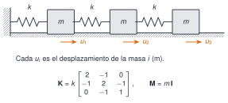

```{julia}
#| include: false
using Resonancia, LinearAlgebra, SparseArrays, Statistics, Random, Markdown
include("../../recursos/_tema.jl")
TORROJA = "../../datos/torroja/"
```

En una estructura discretizada, cada grado de libertad solo interactúa con los vecinos: la mayoría de las entradas de $\mathbf K$ y $\mathbf M$ son cero. Una matriz **dispersa** (*sparse*) es la que tiene muy pocas entradas no nulas; es de **banda** si todas están a distancia $\le b$ de la diagonal ($b$ es el semiancho de banda); es **tridiagonal** si $b=1$; y es **por bloques** si se puede particionar en submatrices.

{#fig-cadena fig-alt="Tres masas iguales en fila, unidas entre sí y a una pared por cuatro muelles, con los desplazamientos u1, u2 y u3 marcados por flechas, y debajo la matriz de rigidez tridiagonal con 2, 2 y 1 en la diagonal y menos 1 en las codiagonales"}

Para $n$ masas $m$ unidas por muelles $k$, con la primera anclada y la última libre, $\mathbf M=m\mathbf I$ y

$$
\mathbf K=k\begin{bmatrix}2&-1&&\\-1&2&-1&\\&\ddots&\ddots&\ddots\\&&-1&1\end{bmatrix}.
$$ {#eq-cadena}

Tiene $3n-2$ entradas no nulas de $n^2$. Julia almacena las matrices dispersas por **columnas comprimidas** (CSC, *compressed sparse column*): en lugar de $n^2$ números guarda tres vectores, `colptr`, `rowval` y `nzval`. Python, con SciPy, admite CSC y también CSR (la misma idea, por filas).

```{julia}
_, K4 = cadena_masas_muelles(4)
(colptr = K4.colptr, rowval = K4.rowval, nzval = K4.nzval)
```

`nzval` guarda los números no nulos columna a columna, `rowval` su fila y `colptr[j]` indica dónde empieza la columna $j$ dentro de los otros dos.

```{julia}
#| label: fig-patrones
#| fig-cap: "Patrón de elementos no nulos de la matriz de rigidez de la cadena de $n=10$ masas (izquierda) y de una malla bidimensional de $5\\times5$ nodos (derecha, 25 grados de libertad): es tridiagonal **por bloques**, con bloques de $5\\times5$ que también son tridiagonales."
#| fig-alt: "Dos cuadrículas con las celdas no nulas en color. La primera, de diez por diez, tiene tres diagonales alrededor de la diagonal principal. La segunda, de veinticinco por veinticinco, tiene una banda ancha de cinco bloques y, dentro de ella, diagonales que se repiten cada cinco celdas."
function patron(K)
    P = Matrix(K) .!= 0
    P
end
_, K10 = cadena_masas_muelles(10)
K1d = Matrix(spdiagm(-1 => fill(-1.0, 4), 0 => fill(2.0, 5), 1 => fill(-1.0, 4)))
Kmalla = kron(I(5), K1d) + kron(K1d, I(5))                                  # malla 5×5: 25 grados de libertad
fig = Figure(size=(860, 400))
for (j, (K, titulo)) in enumerate(((Matrix(K10), "cadena (n = 10): tridiagonal"), (Kmalla, "malla 5×5: tridiagonal por bloques")))
    ax = Axis(fig[1, j]; title=titulo, titlealign=:left, titlesize=13, yreversed=true, aspect=DataAspect(), xlabel="columna", ylabel="fila")
    heatmap!(ax, 1:size(K, 2), 1:size(K, 1), Float64.(patron(K))'; colormap=[:white, AZUL], colorrange=(0, 1))
end
fig
```

**¿Qué se ahorra?** Almacenamiento: de $8n^2$ bytes (densa, `Float64`) a unos $16\cdot(3n-2)+8(n+1)$ (CSC). Tiempo: resolver un sistema tridiagonal cuesta $O(n)$ operaciones; una factorización densa, $O(n^3)$. La tabla compara memoria y tiempos de resolver $\mathbf K\mathbf x=\mathbf f$ en un ordenador concreto.

```{julia}
#| output: asis
function bench(n)
    _, Ks = cadena_masas_muelles(n)
    Kd = Matrix(Ks); b = ones(n)
    Ks \ b; Kd \ b                                        # calentamiento (compilación)
    ts = minimum(@elapsed(Ks \ b) for _ in 1:7)
    td = minimum(@elapsed(Kd \ b) for _ in 1:7)
    (n=n, nnz=nnz(Ks), mem_d=sizeof(Kd), mem_s=Base.summarysize(Ks), ts=ts, td=td)
end
res = [bench(n) for n in (2, 3, 10, 100, 1000, 2000)]
fmt_b(b) = b < 1e3 ? "$(b) B" : b < 1e6 ? "$(coma(b / 1e3; d=1)) kB" : "$(coma(b / 1e6; d=1)) MB"
fmt_t(t) = t < 1e-3 ? "$(coma(t * 1e6; d=1)) µs" : "$(coma(t * 1e3; d=2)) ms"
println("| n | no nulos | densa | dispersa | resolver (densa) | resolver (dispersa) |\n|---|---|---|---|---|---|\n" *
    join(["| $(r.n) | $(r.nnz) | $(fmt_b(r.mem_d)) | $(fmt_b(r.mem_s)) | $(fmt_t(r.td)) | $(fmt_t(r.ts)) |" for r in res], "\n"))
```

: Cadena de masas y muelles: memoria de la matriz de rigidez y tiempo de resolver un sistema con ella, en forma densa y dispersa. Mínimo de 7 ejecuciones en el ordenador que compila esta página. {#tbl-dispersas}

::: {.callout-warning}
## No generalices un único experimento
Los tiempos de la @tbl-dispersas dependen del procesador, de la versión de Julia y de las bibliotecas (cada vez que se compila la página pueden cambiar). Para $n=2$ o $3$ la forma dispersa no ahorra nada, porque la matriz es minúscula y el coste fijo de la estructura domina. Lo que sí es general es la **tendencia**: la memoria densa crece como $n^2$ y la dispersa como $n$; y el coste de resolver, como $n^3$ (densa) frente a un coste casi lineal en $n$ (tridiagonal o de banda). Para otras estructuras (mallas bidimensionales, por ejemplo) el ahorro es menor y depende de cómo se numeren los nodos.
:::

**Factorizaciones adecuadas.** Para una matriz simétrica definida positiva, como la de rigidez de una estructura anclada, se usa la factorización de **Cholesky** $\mathbf K=\mathbf L\mathbf L^{\mathsf T}$, que ocupa la mitad de memoria y no necesita pivotear. Si $\mathbf K$ es de banda con semiancho $b$, $\mathbf L$ también lo es, y el coste baja de $O(n^3)$ a $O(nb^2)$. Un orden de numeración de nodos que reduzca la banda es parte del diseño de un modelo de elementos finitos [@golub2013].

::: {.ejercicio tipo="numerico" id="m2-1-3-nnz" respuesta="298"}
¿Cuántos elementos no nulos tiene la matriz de rigidez de una cadena de $n=100$ masas ($\mathbf K$ de la @eq-cadena)?

::: {.solucion}
$3n-2=298$: $n$ en la diagonal y $n-1$ en cada una de las dos codiagonales. Se comprueba con `nnz(cadena_masas_muelles(100)[2])`.
:::
:::

::: {.ejercicio tipo="opcion" id="m2-1-3-dispersa" respuesta="c"}
Una matriz de rigidez de una estructura con $n=50\,000$ grados de libertad, ¿cómo conviene almacenarla?

::: {.opciones}
- Como matriz densa, porque siempre es más rápida.
- Como matriz densa, pero en simple precisión.
- Como matriz dispersa (simétrica), porque la mayoría de las entradas son cero.
- No se puede almacenar: es demasiado grande.
:::

::: {.solucion}
La **c**. Una matriz densa de $50\,000^2$ elementos `Float64` ocuparía unos $20$ GB, mientras que la dispersa de una estructura con conectividad local tiene del orden de $n$ elementos no nulos por fila y cabe en unas decenas de megabytes.
:::
:::
