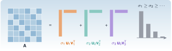

{.portada fig-alt="Una matriz de seis por seis escrita como suma de tres capas de rango uno, cada una con su valor singular, junto a las barras de los valores singulares ordenadas de mayor a menor"}

Si hubiera que quedarse con una sola herramienta de álgebra lineal para trabajar con datos, sería esta. La **descomposición en valores singulares** (SVD, *singular value decomposition*) existe para *cualquier* matriz, rectangular o no, y dice con exactitud qué hace la matriz como aplicación, cuánta información tiene, cuál es su mejor versión más sencilla y cómo invertirla cuando no se puede. En monitorización estructural es la que ordena los datos (qué componentes dominan), la que decide cuántos modos hay (rango numérico) y la que está dentro de los algoritmos de identificación como ERA y SSI.

En [A1](../../algebra/matrices/index.qmd) ya apareció la SVD en dos sitios (la geometría de un sistema mal condicionado y la regularización de un problema inverso). Aquí se estudia por sí misma.

::: {.callout-note}
## Cómo se lee esta unidad
**Tiempo orientativo:** unas 3 horas, con la simulación y los ejercicios. **Nivel:** intermedio. Tres capas: **intuición** (figuras y simulación), **fundamento** (teoremas y demostraciones plegables) y **aplicación** (el edificio de tres plantas del [caso transversal](../../caso/edificio/index.qmd)).
:::


## Objetivos y prerrequisitos

**Objetivos.** Al terminar esta unidad sabrás:

- enunciar la SVD, calcularla con `svd` y relacionarla con los valores propios de $\mathbf A^{\mathsf T}\mathbf A$;
- interpretar los valores singulares como las longitudes de los semiejes de la imagen de la esfera unidad, y la norma 2 y el número de condición en esos términos;
- enunciar y aplicar el teorema de Eckart–Young–Mirsky y medir cuánta «energía» captura una aproximación de rango $r$;
- calcular la pseudoinversa y la solución de mínima norma de un problema de mínimos cuadrados, también con rango deficiente;
- decidir el rango numérico con un umbral razonado, incluida la cota de ruido de una matriz aleatoria;
- aplicar la SVD a registros de varios sensores (POD, *proper orthogonal decomposition*) y comparar sus componentes con los modos físicos.

**Prerrequisitos.** [A1](../../algebra/matrices/index.qmd) (normas y condicionamiento) y [A2](../../algebra/valores-propios/index.qmd) (valores propios y modos).

## Apartados

::: {.indice-unidades .indice-apartados}

| Id | Apartado |
|----|----------|
| A3.1 | [Definición y geometría](a3-1.qmd) |
| A3.2 | [La mejor aproximación de rango $r$](a3-2.qmd) |
| A3.3 | [Pseudoinversa y mínimos cuadrados](a3-3.qmd) |
| A3.4 | [Rango numérico](a3-4.qmd) |
| A3.5 | [La SVD de registros de varios sensores (POD)](a3-5.qmd) |
| A3 | [Práctica y cierre](practica.qmd) |

:::

```{=html}
<script>
// Las anclas de la antigua página única redirigen al apartado nuevo.
(function () {
  var m = {"a3-1": "a3-1.html", "a3-2": "a3-2.html", "a3-3": "a3-3.html", "a3-4": "a3-4.html", "a3-5": "a3-5.html", "def-pseudoinversa": "a3-3.html#def-pseudoinversa", "ej-pinv": "a3-3.html#ej-pinv", "ej-pod": "a3-5.html#ej-pod", "ej-ruido": "a3-4.html#ej-ruido", "fig-pod": "a3-5.html#fig-pod", "lab-svd": "a3-4.html#lab-svd", "limites-sim1": "a3-4.html#limites-sim1", "pideselo": "practica.html#pideselo", "thm-eym": "a3-2.html#thm-eym", "thm-svd": "a3-1.html#thm-svd"};
  var h = decodeURIComponent(location.hash.slice(1));
  if (m[h]) location.replace(m[h]);
})();
</script>
```
