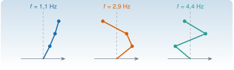

{.portada fig-alt="Tres formas modales de un edificio de tres plantas, dibujadas como líneas quebradas sobre un eje vertical, junto a las frecuencias naturales 1,1 Hz, 2,9 Hz y 4,4 Hz"}

Un **modo de vibración** es una forma de moverse que se conserva: todos los puntos de la estructura oscilan a la vez, con la misma frecuencia, y la forma no cambia con el tiempo. Matemáticamente, un modo es un **vector propio** y su frecuencia sale de un **valor propio**. Casi todo lo que se hace después en monitorización (identificar, comparar estados, detectar daño) trabaja con esas dos cantidades. Esta unidad explica de dónde salen, qué propiedades tienen y qué pasa con ellas cuando la estructura cambia.

::: {.callout-note}
## Cómo se lee esta unidad
**Tiempo orientativo:** unas 3 horas, con la simulación y los ejercicios. **Nivel:** intermedio. Hay tres capas: **intuición** (figuras y simulación), **fundamento** (definiciones, teoremas y demostraciones plegables) y **aplicación** (el edificio de cortante de tres plantas que se usará en todo el curso, definido en [el caso transversal](../../caso/edificio/index.qmd)).
:::


## Objetivos y prerrequisitos

**Objetivos.** Al terminar esta unidad sabrás:

- plantear el problema de valores propios estándar y el generalizado $\mathbf K\boldsymbol\varphi=\omega^2\mathbf M\boldsymbol\varphi$, y explicar por qué el segundo es el de las estructuras;
- demostrar que, con $\mathbf K$ y $\mathbf M$ simétricas y $\mathbf M$ definida positiva, las frecuencias son reales y los modos son ortogonales respecto de $\mathbf M$ y de $\mathbf K$;
- normalizar los modos a masa unidad y usarlos para desacoplar las ecuaciones del movimiento;
- calcular el cociente de Rayleigh y saber qué acota;
- predecir, a primer orden, cuánto cambian las frecuencias cuando cambia la rigidez de un entrepiso, y comparar con el cálculo exacto;
- explicar por qué los modos son *menos sensibles* que las frecuencias a un daño local, y por qué las matrices no simétricas se comportan mucho peor.

**Prerrequisitos.** [A1 Matrices estructuradas](../../algebra/matrices/index.qmd), para la simetría, la definición positiva y el MAC, y [M5](https://me1catrr.github.io/resonancia/mse/m05-vibraciones-i/index.html) para el sistema de un grado de libertad. Julia básico ([J1](https://me1catrr.github.io/resonancia/julia/j1-esencial/index.html)) y álgebra lineal numérica ([J3.3](https://me1catrr.github.io/resonancia/julia/j3-computacion/j3-3-algebra-numerica/index.html)).

## Apartados

::: {.indice-unidades .indice-apartados}

| Id | Apartado |
|----|----------|
| A2.1 | [El problema estándar](a2-1.qmd) |
| A2.2 | [El problema generalizado de una estructura](a2-2.qmd) |
| A2.3 | [Los modos del edificio](a2-3.qmd) |
| A2.4 | [Sensibilidad a la rigidez](a2-4.qmd) |
| A2 | [Práctica y cierre](practica.qmd) |

:::

```{=html}
<script>
// Las anclas de la antigua página única redirigen al apartado nuevo.
(function () {
  var m = {"a2-1": "a2-1.html", "a2-2": "a2-2.html", "a2-3": "a2-3.html", "a2-4": "a2-4.html", "def-propio": "a2-1.html#def-propio", "def-rayleigh": "a2-2.html#def-rayleigh", "eq-generalizado": "a2-2.html#eq-generalizado", "eq-perturbacion": "a2-4.html#eq-perturbacion", "fig-modos-edificio": "a2-3.html#fig-modos-edificio", "lab-modos": "a2-4.html#lab-modos", "limites-sim1": "a2-4.html#limites-sim1", "pideselo": "practica.html#pideselo", "tbl-modos-edificio": "a2-3.html#tbl-modos-edificio", "tbl-sensibilidad": "a2-4.html#tbl-sensibilidad", "thm-espectral": "a2-1.html#thm-espectral", "thm-modos": "a2-2.html#thm-modos"};
  var h = decodeURIComponent(location.hash.slice(1));
  if (m[h]) location.replace(m[h]);
})();
</script>
```
