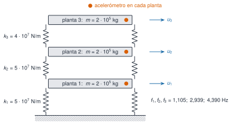

```{julia}
#| include: false
using Resonancia, LinearAlgebra, Statistics, DelimitedFiles, Printf, Markdown
include("../../recursos/_tema.jl")
RUTA = "../../datos/edificio-3-plantas/"
M3, C3, K3 = edificio_tres_plantas()
f3, Phi3 = modos_propios(K3, M3)
zeta3 = diag(Phi3' * C3 * Phi3) ./ (2 .* 2π .* f3)
```

{#fig-edificio fig-alt="Esquema de un edificio de tres plantas: tres losas rectangulares unidas al suelo y entre sí por muelles verticales a ambos lados, con las rigideces de cada entrepiso, un punto naranja que marca el acelerómetro de cada planta y flechas con los desplazamientos de cada una."}

Las ecuaciones son las de [A2](../../algebra/valores-propios/index.qmd) y [S2](../../sistemas/espacio-estados/index.qmd): $\mathbf M\ddot{\mathbf u}+\mathbf C\dot{\mathbf u}+\mathbf K\mathbf u=\mathbf f(t)$, con $\mathbf M=m\mathbf I$, $\mathbf K$ tridiagonal (`edificio_cortante`) y amortiguamiento de Rayleigh $\mathbf C=\alpha\mathbf M+\beta\mathbf K$ elegido para que $\zeta=1\,\%$ en los dos primeros modos. Se excita con fuerzas de ruido blanco independientes en las tres plantas (desviación típica $2\cdot10^4$ N por muestra) y se mide la aceleración absoluta de cada planta a 100 Hz, con ruido de sensor de $0{,}002$ m/s².

```{julia}
#| label: tbl-modos
#| tbl-cap: "Propiedades modales verdaderas del escenario A."
filas = ["| $j | $(coma(f3[j]; d=3)) | $(coma(100 * zeta3[j]; d=2)) | $(join(coma.(Phi3[:, j] ./ Phi3[argmax(abs.(Phi3[:, j])), j]; d=3), "; ")) |" for j in 1:3]
Markdown.parse("| Modo | f (Hz) | ζ (%) | Forma (plantas 1; 2; 3) |\n|:--:|--:|--:|:--|\n" * join(filas, "\n"))
```

## Los tres escenarios

| Escenario | Qué representa | Cambio en el modelo | Archivo |
|:--|:--|:--|:--|
| **A** | Estado de referencia | ninguno | `escenario_A.csv` |
| **B** | Variabilidad ambiental (p. ej., temperatura) | las tres rigideces un $1\,\%$ menores | `escenario_B.csv` |
| **C** | Daño localizado | el entrepiso 2 pierde un $10\,\%$ de rigidez | `escenario_C.csv` |

: Escenarios del caso transversal. Cada registro dura 600 s a 100 Hz, con una semilla distinta. {#tbl-escenarios}

El **objetivo pedagógico** es la pregunta central de la monitorización: ¿un cambio de frecuencias es un daño o es variabilidad? En B todo cambia un poco y de forma coherente (las frecuencias bajan todas un $0{,}5\,\%$); en C cambia de forma desigual y las formas modales se alteran levemente.

```{julia}
#| label: tbl-cambios
#| tbl-cap: "Frecuencias verdaderas de cada escenario, variación respecto de A y MAC con las formas de A."
res = Dict{Symbol,Any}()
for e in (:A, :B, :C)
    M, _, K = edificio_tres_plantas(escenario=e)
    res[e] = modos_propios(K, M)
end
filas = String[]
for e in (:B, :C), j in 1:3
    f, P = res[e]
    push!(filas, "| $e | $j | $(coma(res[:A][1][j]; d=3)) | $(coma(f[j]; d=3)) | $(coma(100 * (f[j] / res[:A][1][j] - 1); d=2)) % | $(coma(mac(res[:A][2][:, j], P[:, j]); d=4)) |")
end
Markdown.parse("| Escenario | Modo | f en A (Hz) | f (Hz) | Δf/f | MAC |\n|:--:|:--:|--:|--:|--:|--:|\n" * join(filas, "\n"))
```

Las frecuencias del escenario C bajan $1{,}85\,\%$, $0{,}24\,\%$ y $3{,}11\,\%$ (de forma desigual, como predice la perturbación de [A2](../../algebra/valores-propios/index.qmd)), y el MAC se mantiene por encima de $0{,}999$.
