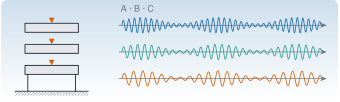

{.portada fig-alt="Un edificio de tres plantas con un acelerómetro en cada planta, junto a tres registros de aceleración de distinta frecuencia"}

Un único modelo, conocido al detalle, que se usa en todo el curso: un **edificio de cortante de tres plantas** con tres acelerómetros. Al ser sintético, se sabe de antemano la respuesta correcta (frecuencias, amortiguamientos y formas modales), de modo que cada método de identificación y de detección de cambios se puede **validar** contra la verdad. Los datos son los de `datos/edificio-3-plantas/`; el código que los genera está en `scripts/generar_edificio.jl`.

::: {.callout-note}
## Qué es y qué no es
Es un banco de pruebas, no un edificio real. Sirve para aprender y para comprobar que un algoritmo hace lo que dice; **no** demuestra que ese algoritmo funcione en una estructura real, con ruido coloreado, no linealidades y variaciones ambientales mucho más complejas. Para datos reales, véanse los puentes de [R1](https://me1catrr.github.io/resonancia/recursos/index.html).
:::

## Apartados

::: {.indice-unidades .indice-apartados}

| Id | Apartado |
|----|----------|
| E.1 | [El modelo y los tres escenarios](e-1.qmd) |
| E.2 | [Primer vistazo a los datos](e-2.qmd) |
| E | [Práctica y cierre](practica.qmd) |

:::

## Cómo se usa el caso en el resto del curso

| Página | Qué se hace con el edificio |
|:--|:--|
| [A2](../../algebra/valores-propios/index.qmd) | modos, sensibilidad y MAC |
| [A3](../../algebra/svd/index.qmd) | POD de los tres sensores |
| [S1](../../sistemas/laplace/index.qmd) | receptancias, ceros y antirresonancias |
| [S2](../../sistemas/espacio-estados/index.qmd) | espacio de estados, observabilidad, simulación |
| [S3](../../sistemas/transformada-z/index.qmd) | polos con un modelo AR y polos espurios |

: Dónde aparece el edificio. En las fases siguientes se usará también para correlación, FDD, SSI y detección de cambios. {#tbl-usos}

```{=html}
<script>
// Las anclas de la antigua página única redirigen al apartado nuevo.
(function () {
  var m = {"e-1": "e-1.html", "e-2": "e-2.html", "fig-edificio": "e-1.html#fig-edificio", "fig-psd": "e-2.html#fig-psd", "pideselo": "practica.html#pideselo", "tbl-cambios": "e-1.html#tbl-cambios", "tbl-escenarios": "e-1.html#tbl-escenarios", "tbl-modos": "e-1.html#tbl-modos", "tbl-picos": "e-2.html#tbl-picos"};
  var h = decodeURIComponent(location.hash.slice(1));
  if (m[h]) location.replace(m[h]);
})();
</script>
```
