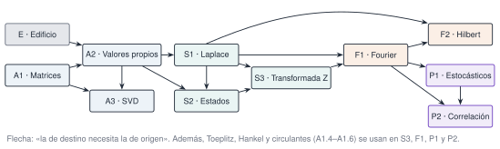

Las matrices, los valores propios, las transformadas y los procesos aleatorios no son un trámite previo al análisis de vibraciones: son el análisis de vibraciones. En **matematicado** cada herramienta matemática se aprende respondiendo a una pregunta concreta sobre una estructura. ¿Qué frecuencias y amortiguamientos tiene un edificio? ¿Por qué dos sensores del mismo edificio ven picos distintos? ¿Cuánto hay que medir para separar dos modos? ¿Cuándo un amortiguamiento estimado es fiable?

Todo gira alrededor de un mismo banco de pruebas, un [edificio de tres plantas](caso/edificio/index.qmd) cuyas respuestas correctas se conocen, para poder comprobar cada método contra la verdad. El código es [Julia](https://julialang.org) (con la versión Python equivalente en pestañas) y cada página trae simulaciones interactivas que funcionan en el navegador, ejercicios autocorregibles y propuestas para trabajar con [Claude Code](https://claude.com/claude-code) como asistente.

::: {.callout-note}
## Para quién es
Para estudiantes de ingeniería (máster o últimos cursos de grado) e ingenieros en ejercicio que quieran entender y no solo aplicar los métodos de análisis modal y de señales. Se suponen álgebra lineal y cálculo de primer curso y nociones de vibraciones de un grado de libertad; lo que falte se enlaza con [Resonancia](https://me1catrr.github.io/resonancia/), el curso del que nace este material.
:::

## El temario

Cinco bloques y once páginas. Cada página dura entre 3 y 4 horas con la práctica y se puede estudiar sola si se tienen sus prerrequisitos.

::: {.indice-unidades .indice-detalle}

| Id | Página | Qué se estudia | Tiempo |
|----|--------|----------------|--------|
| E | [Un edificio de tres plantas](caso/edificio/index.qmd) | El modelo de cortante, sus tres escenarios (referencia, variabilidad ambiental y daño localizado) y una primera lectura de los datos, con la dispersión del estimador. | 1 h |
| A1 | [Matrices estructuradas](algebra/matrices/index.qmd) | Normas, condicionamiento y mínimos cuadrados; matrices simétricas, definidas positivas, dispersas y de banda; Toeplitz, Hankel y circulantes, con sus usos en predicción, SSA, ERA y convolución. | 4 h |
| A2 | [Valores propios](algebra/valores-propios/index.qmd) | Modos y frecuencias como problema de valores propios generalizado: ortogonalidad, normalización a masa unidad, cociente de Rayleigh y sensibilidad a un cambio de rigidez. | 3 h |
| A3 | [Descomposición en valores singulares](algebra/svd/index.qmd) | Geometría de la SVD, mejor aproximación de rango $r$, pseudoinversa, rango numérico y POD de registros de varios sensores. | 3 h |
| S1 | [Laplace y función de transferencia](sistemas/laplace/index.qmd) | Polos (frecuencias, amortiguamientos, estabilidad), ceros y antirresonancias; respuesta en frecuencia de un sistema de varios grados de libertad. | 3 h |
| S2 | [Espacio de estados](sistemas/espacio-estados/index.qmd) | De segundo a primer orden, observabilidad y controlabilidad, discretización exacta con retenedor de orden cero y simulación. | 3 h |
| S3 | [Transformada Z](sistemas/transformada-z/index.qmd) | Planos $s$ y $z$, aliasing, y polos de un modelo autorregresivo para estimar frecuencias y amortiguamientos, con sus polos espurios. | 3 h |
| F1 | [Fourier](senales/fourier/index.qmd) | Series, transformada y DFT; resolución y Nyquist; fuga espectral y ventanas; escalado de espectros de amplitud y de densidad espectral. | 4 h |
| F2 | [Hilbert y señal analítica](senales/hilbert/index.qmd) | Envolvente y frecuencia instantáneas, amortiguamiento a partir de la respuesta libre y fallos típicos (varias componentes, bordes y ruido). | 3 h |
| P1 | [Procesos estocásticos](probabilidad/estocasticos/index.qmd) | Variables aleatorias, estacionariedad y ergodicidad, ruido blanco y AR(1), respuesta de un sistema lineal a ruido blanco. | 3 h |
| P2 | [Correlación](probabilidad/correlacion/index.qmd) | Autocorrelación y correlación cruzada, retardos, Wiener–Khinchin y ERA sobre correlaciones para identificar los modos del edificio. | 3 h |

:::

**Total: unas 33 horas.** Son estimaciones orientativas, no datos de ninguna asignatura.

## En qué orden

El orden de los identificadores no es el de las dependencias: Fourier (F1), por ejemplo, se apoya en el muestreo y el aliasing de la transformada Z (S3).

{#fig-mapa fig-alt="Diagrama de flechas entre las once páginas. E y A1 llevan a A2; A1 y A2 a A3; A2 a S1 y S2; S1 a S2, S3, F1 y F2; S2 a S3; S3 a F1; F1 a F2, P1 y P2; P1 a P2. Una nota indica que Toeplitz, Hankel y circulantes (A1.4 a A1.6) se usan en S3, F1, P1 y P2."}

Un orden de lectura válido es E → A1 → A2 → A3 → S1 → S2 → S3 → F1 → F2 → P1 → P2. A3 (SVD) no bloquea a ninguna otra y se puede dejar para el final.

## Tres itinerarios

::: {.callout-tip .idea-clave title="Elige según el tiempo que tengas"}
**Exprés (4 h).** Lo que se da por sabido en todo lo demás: [E](caso/edificio/index.qmd); de A1, la simetría y la definición positiva ([A1.2](algebra/matrices/a1-2.qmd)) y el MAC ([A1.7](algebra/matrices/a1-7.qmd)); [A2](algebra/valores-propios/index.qmd) completa; los polos y su relación con los valores propios ([S1.1](sistemas/laplace/s1-1.qmd) a [S1.3](sistemas/laplace/s1-3.qmd)); la DFT, la resolución y la fuga ([F1.3](senales/fourier/f1-3.qmd) y [F1.4](senales/fourier/f1-4.qmd)) y el aliasing ([S3.2](sistemas/transformada-z/s3-2.qmd)). Es el recorrido de la [sesión M2 de Resonancia](https://me1catrr.github.io/resonancia/mse/m02-matematicas/index.html), que lo condensa en una clase.

**Esencial (unas 12 h).** E, A2, S1 y F1 completas, más A1.2, A1.7 y S3.2. Con esto se lee con criterio un espectro y una tabla de modos.

**Identificación (unas 20 h).** El esencial más [A1.4–A1.5](algebra/matrices/a1-4.qmd) (Toeplitz y Hankel), S3, P1 y P2. Es la base matemática de los métodos de identificación modal operacional (ERA, FDD y SSI).

**Completo (unas 33 h).** Todas las páginas, en el orden del mapa.
:::

## Cómo se trabaja

Cada unidad tiene una portada con sus objetivos y prerrequisitos, una página por apartado con la teoría en tres capas (intuición, fundamento y aplicación), laboratorios interactivos, práctica guiada en Julia y Python, una propuesta de trabajo con Claude con su apartado *Verifica*, ejercicios y una lista de comprobación final, reunidos en su página de práctica y cierre. Los detalles, y cómo montar el entorno, están en [Cómo estudiar aquí](como-estudiar.qmd).

::: {.ejercicio tipo="abierta" id="mat-tres-caminos"}
Para medir tu punto de partida: tienes un registro de aceleración de la cubierta del edificio de tres plantas y quieres estimar la frecuencia y el amortiguamiento del primer modo. Nombra tres caminos distintos que lo permitan y, para cada uno, la condición que exige. Vuelve a esta pregunta cuando termines el itinerario de identificación.

::: {.rubrica}
- Propongo un modelo AR ajustado con Yule–Walker y leo la frecuencia y el amortiguamiento en sus polos (S3), con cuidado con los polos espurios y con el sesgo del amortiguamiento.
- Propongo aislar el modo y usar la señal analítica de su respuesta libre (F2), lo que exige banda estrecha, un solo modo y descartar los bordes y el suelo de ruido.
- Propongo estimar correlaciones y aplicar ERA (P2), lo que exige una excitación aproximadamente de ruido blanco.
- Señalo que el amortiguamiento sale menos fiable que la frecuencia.
:::

::: {.solucion}
Los caminos de [S3](sistemas/transformada-z/index.qmd), [F2](senales/hilbert/index.qmd) y [P2](probabilidad/correlacion/index.qmd). (1) Un **modelo AR** cuyos polos, convertidos con $\ln z/\Delta t$, dan $f$ y $\zeta$; exige elegir bien el orden y distinguir los polos espurios. (2) La **señal analítica** de la respuesta libre de un modo aislado, con $\zeta$ a partir de la pendiente de $\ln A(t)$; exige banda estrecha, sin bordes ni suelo de ruido. (3) Las **correlaciones** de las respuestas y **ERA**; exige excitación de ruido blanco. En los tres, el amortiguamiento es menos fiable que la frecuencia.
:::
:::

## Licencia y origen

Los textos, las figuras y las diapositivas se publican bajo [CC BY-SA 4.0](https://creativecommons.org/licenses/by-sa/4.0/deed.es); el código, bajo licencia MIT. El material procede de la sesión M2 de [Resonancia](https://me1catrr.github.io/resonancia/) (Rafael Castro Triguero, Universidad de Córdoba) y usa su paquete [Resonancia.jl](https://github.com/me1catrr/resonancia/tree/main/Resonancia.jl).
