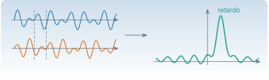

{.portada fig-alt="Dos señales idénticas desplazadas en el tiempo, una encima de otra, y a la derecha su correlación cruzada con un pico claro en el valor del retardo"}

La **correlación** mide cuánto se parecen dos señales cuando una se desplaza respecto de la otra. Con ella se estima un retardo (¿cuánto tarda la onda en llegar del sensor 1 al 2?), se mide la memoria de una señal (la autocorrelación) y —lo más importante para este curso— **se extrae la respuesta libre de un sistema excitado con ruido**: la correlación de las respuestas de una estructura bajo excitación ambiental se comporta como una vibración libre que decae, y es el material de entrada de los métodos de identificación modal.

::: {.callout-note}
## Cómo se lee esta unidad
**Tiempo orientativo:** unas 3 horas. **Nivel:** intermedio. Tres capas: **intuición** (laboratorio de retardos), **fundamento** (definiciones, propiedades y estimación) y **aplicación** (identificar los modos del edificio a partir de correlaciones).
:::


## Objetivos y prerrequisitos

**Objetivos.** Al terminar esta unidad sabrás:

- definir covarianza, correlación, autocorrelación y correlación cruzada, y estimarlas con `autocorrelacion` y `correlacion_cruzada`;
- enunciar las propiedades de la autocorrelación (simetría, cota, Toeplitz semidefinida positiva) y el teorema de Wiener–Khinchin;
- estimar un retardo entre dos señales y decidir si un pico de correlación es significativo;
- explicar por qué, con excitación de ruido blanco, la correlación de las respuestas tiene la forma de una respuesta libre;
- aplicar ERA a correlaciones para estimar frecuencias y amortiguamientos de un edificio, y valorar la calidad del resultado;
- calcular la autocorrelación con la FFT.

**Prerrequisitos.** [P1](../../probabilidad/estocasticos/index.qmd) (procesos estacionarios), [F1](../../senales/fourier/index.qmd) (DFT) y [A1.4–A1.5](../../algebra/matrices/a1-4.qmd) (Toeplitz y Hankel).

## Apartados

::: {.indice-unidades .indice-apartados}

| Id | Apartado |
|----|----------|
| P2.1 | [Definiciones y estimación](p2-1.qmd) |
| P2.2 | [Estimar un retardo](p2-2.qmd) |
| P2.3 | [La correlación como respuesta libre](p2-3.qmd) |
| P2.4 | [Los modos del edificio a partir de correlaciones](p2-4.qmd) |
| P2 | [Práctica y cierre](practica.qmd) |

:::

```{=html}
<script>
// Las anclas de la antigua página única redirigen al apartado nuevo.
(function () {
  var m = {"eq-corr": "p2-1.html#eq-corr", "eq-lambda": "p2-3.html#eq-lambda", "fig-correlaciones": "p2-4.html#fig-correlaciones", "lab-correlacion": "p2-2.html#lab-correlacion", "limites-sim1": "p2-2.html#limites-sim1", "p2-1": "p2-1.html", "p2-2": "p2-2.html", "p2-3": "p2-3.html", "p2-4": "p2-4.html", "pideselo": "practica.html#pideselo", "tbl-era-corr": "p2-4.html#tbl-era-corr"};
  var h = decodeURIComponent(location.hash.slice(1));
  if (m[h]) location.replace(m[h]);
})();
</script>
```
