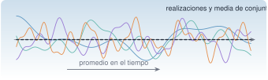

{.portada fig-alt="Cuatro realizaciones de colores distintos de un proceso aleatorio sobre un eje horizontal y una línea discontinua negra que representa su media de conjunto"}

La vibración ambiental de un puente o de un edificio (viento, tráfico, microtremores) no se repite: cada registro es **una realización** de un proceso aleatorio. No se puede predecir su valor en un instante, pero sí sus **propiedades estadísticas**: la media, la varianza, la autocorrelación, el espectro. La identificación modal con excitación ambiental se apoya en dos hipótesis sobre ese proceso, **estacionariedad** y **ergodicidad**, que casi nunca se comprueban y casi siempre se suponen. Esta unidad las define, muestra cómo fallan y cómo se detectan.

::: {.callout-note}
## Cómo se lee esta unidad
**Tiempo orientativo:** unas 3 horas. **Nivel:** intermedio. Tres capas: **intuición** (laboratorio con conjuntos de realizaciones), **fundamento** (definiciones y teoremas) y **aplicación** (registros del edificio y respuesta de un sistema lineal a ruido blanco).
:::


## Objetivos y prerrequisitos

**Objetivos.** Al terminar esta unidad sabrás:

- calcular media, varianza y covarianza de variables aleatorias y distinguir correlación de independencia;
- definir un proceso estocástico, su media de conjunto y su autocorrelación;
- distinguir estacionariedad débil de ergodicidad y comprobar, con simulaciones, qué pasa si fallan;
- reconocer el ruido blanco y el AR(1) y calcular su autocorrelación;
- enunciar la relación entrada–salida de un sistema lineal con ruido blanco, $S_{yy}=\lvert H\rvert^2S_{ff}$, y su consecuencia para la identificación;
- evaluar la estacionariedad de un registro con estadísticas por ventanas.

**Prerrequisitos.** [J2.5 · Distribuciones y Monte Carlo](https://me1catrr.github.io/resonancia/julia/j2-datos/j2-5-montecarlo/index.html), [F1](../../senales/fourier/index.qmd) y [A1.4](../../algebra/matrices/a1-4.qmd).

## Apartados

::: {.indice-unidades .indice-apartados}

| Id | Apartado |
|----|----------|
| P1.1 | [Variables aleatorias](p1-1.qmd) |
| P1.2 | [Procesos estocásticos](p1-2.qmd) |
| P1.3 | [Respuesta de un sistema lineal a ruido blanco](p1-3.qmd) |
| P1.4 | [El registro del edificio](p1-4.qmd) |
| P1 | [Práctica y cierre](practica.qmd) |

:::

```{=html}
<script>
// Las anclas de la antigua página única redirigen al apartado nuevo.
(function () {
  var m = {"def-ergodico": "p1-2.html#def-ergodico", "def-estacionario": "p1-2.html#def-estacionario", "def-proceso": "p1-2.html#def-proceso", "ej-conjunto": "p1-3.html#ej-conjunto", "eq-syy": "p1-3.html#eq-syy", "fig-rms": "p1-4.html#fig-rms", "lab-estocasticos": "p1-2.html#lab-estocasticos", "limites-sim1": "p1-2.html#limites-sim1", "p1-1": "p1-1.html", "p1-2": "p1-2.html", "p1-3": "p1-3.html", "p1-4": "p1-4.html", "pideselo": "practica.html#pideselo", "tbl-ergodico": "p1-3.html#tbl-ergodico"};
  var h = decodeURIComponent(location.hash.slice(1));
  if (m[h]) location.replace(m[h]);
})();
</script>
```
