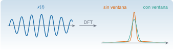

{.portada fig-alt="Una señal sinusoidal modulada a la izquierda y, a la derecha, dos espectros del mismo pico: uno con lóbulos laterales largos, sin ventana, y otro más estrecho y limpio, con ventana"}

La transformada de Fourier descompone una señal en sinusoides. En vibraciones es la herramienta que convierte un registro temporal en lo que se interpreta: **¿a qué frecuencias vibra la estructura y con cuánta energía?** Pero un registro real es finito, discreto y ruidoso, y esos tres hechos tienen consecuencias que hay que dominar: la resolución en frecuencia, la *fuga espectral* (*leakage*), las ventanas y el *aliasing*. Esta unidad explica la teoría y esas consecuencias; la práctica con registros reales y el método de Welch está en [M3.5](https://me1catrr.github.io/resonancia/mse/m03-senales-i/index.html#m3-5)–[M3.6](https://me1catrr.github.io/resonancia/mse/m03-senales-i/index.html#m3-6).

::: {.callout-note}
## Cómo se lee esta unidad
**Tiempo orientativo:** unas 4 horas. **Nivel:** intermedio. Tres capas: **intuición** (laboratorio de fuga y ventanas), **fundamento** (series, transformada, DFT y sus propiedades) y **aplicación** (el edificio de tres plantas).
:::


## Objetivos y prerrequisitos

**Objetivos.** Al terminar esta unidad sabrás:

- escribir la serie de Fourier de una señal periódica y enunciar la relación de Parseval;
- pasar de la transformada continua a la **DFT** y calcular la resolución $\Delta f=f_{\mathrm s}/N$ y la frecuencia de Nyquist;
- explicar la **fuga espectral** y escoger una ventana comparando su ganancia coherente, su ancho de banda de ruido y sus lóbulos laterales;
- distinguir resolución (la da la duración del registro) de interpolación (la da el relleno de ceros);
- escalar correctamente un espectro de amplitud y una densidad espectral de potencia;
- relacionar la DFT con el análisis de un registro de una estructura.

**Prerrequisitos.** [S1](../../sistemas/laplace/index.qmd) (transformada de Laplace) y [S3](../../sistemas/transformada-z/index.qmd) (muestreo y aliasing). [A1.6](../../algebra/matrices/a1-6.qmd) para la DFT como diagonalización de las circulantes.

## Apartados

::: {.indice-unidades .indice-apartados}

| Id | Apartado |
|----|----------|
| F1.1 | [Series de Fourier](f1-1.qmd) |
| F1.2 | [Transformada de Fourier](f1-2.qmd) |
| F1.3 | [La DFT](f1-3.qmd) |
| F1.4 | [Fuga espectral y ventanas](f1-4.qmd) |
| F1.5 | [La resolución en el edificio](f1-5.qmd) |
| F1 | [Práctica y cierre](practica.qmd) |

:::

```{=html}
<script>
// Las anclas de la antigua página única redirigen al apartado nuevo.
(function () {
  var m = {"eq-dft": "f1-3.html#eq-dft", "eq-fourier": "f1-2.html#eq-fourier", "eq-serie": "f1-1.html#eq-serie", "f1-1": "f1-1.html", "f1-2": "f1-2.html", "f1-3": "f1-3.html", "f1-4": "f1-4.html", "f1-5": "f1-5.html", "fig-fuga": "f1-4.html#fig-fuga", "fig-resolucion": "f1-5.html#fig-resolucion", "lab-fourier": "f1-4.html#lab-fourier", "limites-sim1": "f1-4.html#limites-sim1", "pideselo": "practica.html#pideselo", "tbl-dft": "f1-3.html#tbl-dft", "tbl-ventanas": "f1-4.html#tbl-ventanas"};
  var h = decodeURIComponent(location.hash.slice(1));
  if (m[h]) location.replace(m[h]);
})();
</script>
```
