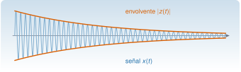

{.portada fig-alt="Una oscilación que decae, dibujada en azul, con su envolvente superior e inferior dibujadas en naranja como una curva exponencial decreciente"}

Una oscilación que decae tiene dos cosas que interesan: **cuánto oscila** (la amplitud, que va bajando) y **cuán deprisa** (la frecuencia, que en un oscilador lineal es constante). La transformada de Hilbert permite separarlas en cada instante: da la **envolvente** y la **fase instantánea** de una señal. En vibraciones sirve, sobre todo, para estimar el amortiguamiento de un modo a partir de su respuesta libre y para ver si la frecuencia depende de la amplitud (no linealidad). Pero tiene una condición de uso estricta —la señal debe ser de banda estrecha— y su incumplimiento es la fuente habitual de resultados absurdos.

::: {.callout-note}
## Cómo se lee esta unidad
**Tiempo orientativo:** unas 3 horas. **Nivel:** intermedio. Tres capas: **intuición** (laboratorio con dos componentes), **fundamento** (señal analítica y sus propiedades) y **aplicación** (amortiguamiento del primer modo del edificio).
:::


## Objetivos y prerrequisitos

**Objetivos.** Al terminar esta unidad sabrás:

- definir la señal analítica y calcularla con la FFT (`hilbert_analitica`);
- obtener la envolvente, la fase y la frecuencia instantáneas de una señal y saber cuándo tienen sentido;
- estimar la frecuencia y el amortiguamiento de un modo a partir de su respuesta libre;
- reconocer los fallos habituales: señales multicomponente, bordes y ruido.

**Prerrequisitos.** [F1](../../senales/fourier/index.qmd) (DFT y fuga) y [S1](../../sistemas/laplace/index.qmd) (respuesta de un oscilador).

## Apartados

::: {.indice-unidades .indice-apartados}

| Id | Apartado |
|----|----------|
| F2.1 | [Señal analítica](f2-1.qmd) |
| F2.2 | [Cuándo tienen sentido](f2-2.qmd) |
| F2.3 | [Efectos de borde y ruido](f2-3.qmd) |
| F2.4 | [Amortiguamiento del primer modo del edificio](f2-4.qmd) |
| F2 | [Práctica y cierre](practica.qmd) |

:::

```{=html}
<script>
// Las anclas de la antigua página única redirigen al apartado nuevo.
(function () {
  var m = {"def-analitica": "f2-1.html#def-analitica", "ej-hilbert-edificio": "f2-4.html#ej-hilbert-edificio", "eq-instantaneas": "f2-1.html#eq-instantaneas", "f2-1": "f2-1.html", "f2-2": "f2-2.html", "f2-3": "f2-3.html", "f2-4": "f2-4.html", "fig-envolvente": "f2-4.html#fig-envolvente", "lab-hilbert": "f2-2.html#lab-hilbert", "limites-sim1": "f2-2.html#limites-sim1", "pideselo": "practica.html#pideselo"};
  var h = decodeURIComponent(location.hash.slice(1));
  if (m[h]) location.replace(m[h]);
})();
</script>
```
