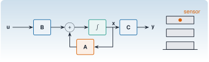

{.portada fig-alt="Diagrama de bloques de un sistema en espacio de estados, con las matrices B, A y C y un integrador, junto a un edificio de tres plantas con un sensor en la cubierta"}

La ecuación del movimiento de una estructura es de segundo orden: relaciona desplazamientos, velocidades y aceleraciones. La **representación en espacio de estados** la reescribe como un sistema de primer orden en un vector que reúne todo lo que hace falta para predecir el futuro: el **estado**. Es el idioma común de la identificación (ERA, SSI), del filtrado de Kalman y de la simulación numérica, y permite hacer con una sola fórmula tres cosas que parecen distintas: simular, preguntar qué se puede medir, y pasar de tiempo continuo a datos muestreados.

::: {.callout-note}
## Cómo se lee esta unidad
**Tiempo orientativo:** unas 3 horas. **Nivel:** intermedio. Tres capas: **intuición** (diagrama de bloques y simulación), **fundamento** (definiciones, observabilidad y discretización exacta) y **aplicación** (el edificio de tres plantas, [caso transversal](../../caso/edificio/index.qmd), cuyos datos sintéticos se generan exactamente con la discretización de esta unidad).
:::


## Objetivos y prerrequisitos

**Objetivos.** Al terminar esta unidad sabrás:

- escribir en espacio de estados un sistema de segundo orden de varios grados de libertad, con salidas de desplazamiento, velocidad o aceleración;
- pasar del espacio de estados a la función de transferencia $\mathbf C(s\mathbf I-\mathbf A)^{-1}\mathbf B+\mathbf D$ y reconocer que la representación no es única;
- construir las matrices de observabilidad y controlabilidad, interpretar su rango y explicar por qué un sensor en un nodo no ve ese modo;
- discretizar con retenedor de orden cero, entender por qué es exacta, y por qué el método de Euler explícito puede inestabilizar una estructura;
- simular la respuesta de un edificio con la recursión $\mathbf x_{k+1}=\mathbf A_{\mathrm d}\mathbf x_k+\mathbf B_{\mathrm d}\mathbf u_k$.

**Prerrequisitos.** [A2](../../algebra/valores-propios/index.qmd) y [S1](../../sistemas/laplace/index.qmd). Para ecuaciones diferenciales, [J3.6](https://me1catrr.github.io/resonancia/julia/j3-computacion/j3-6-edos/index.html).

## Apartados

::: {.indice-unidades .indice-apartados}

| Id | Apartado |
|----|----------|
| S2.1 | [De la ecuación de segundo orden a la de primer orden](s2-1.qmd) |
| S2.2 | [Controlabilidad y observabilidad](s2-2.qmd) |
| S2.3 | [Discretización exacta](s2-3.qmd) |
| S2.4 | [Simulación de la respuesta](s2-4.qmd) |
| S2 | [Práctica y cierre](practica.qmd) |

:::

```{=html}
<script>
// Las anclas de la antigua página única redirigen al apartado nuevo.
(function () {
  var m = {"def-estado": "s2-1.html#def-estado", "def-obs": "s2-2.html#def-obs", "ej-cadena": "s2-2.html#ej-cadena", "ej-transferencia": "s2-1.html#ej-transferencia", "eq-acelerometro": "s2-1.html#eq-acelerometro", "eq-estado": "s2-1.html#eq-estado", "eq-zoh": "s2-3.html#eq-zoh", "fig-bloques": "s2-1.html#fig-bloques", "fig-respuesta": "s2-4.html#fig-respuesta", "lab-obs": "s2-2.html#lab-obs", "limites-sim1": "s2-2.html#limites-sim1", "pideselo": "practica.html#pideselo", "s2-1": "s2-1.html", "s2-2": "s2-2.html", "s2-3": "s2-3.html", "s2-4": "s2-4.html", "tbl-discretizacion": "s2-3.html#tbl-discretizacion", "tbl-visibilidad": "s2-2.html#tbl-visibilidad"};
  var h = decodeURIComponent(location.hash.slice(1));
  if (m[h]) location.replace(m[h]);
})();
</script>
```
