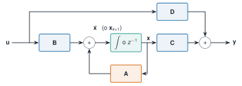

```{julia}
#| include: false
using Resonancia, LinearAlgebra, Statistics, Printf, Markdown
include("../../recursos/_tema.jl")
M3, C3, K3 = edificio_tres_plantas()
f3, Phi3 = modos_propios(K3, M3)
A3, B3 = espacio_estados(M3, C3, K3, [0.0, 0.0, 1.0])
```

Sea $\mathbf M\ddot{\mathbf q}+\mathbf C\dot{\mathbf q}+\mathbf K\mathbf q=\mathbf B_2\mathbf u$, con $\mathbf u$ las fuerzas aplicadas y $\mathbf B_2$ la matriz que dice dónde. Si se toma como **estado** $\mathbf x=\begin{bmatrix}\mathbf q\\\dot{\mathbf q}\end{bmatrix}$, resulta

$$
\dot{\mathbf x}=\underbrace{\begin{bmatrix}\mathbf 0&\mathbf I\\-\mathbf M^{-1}\mathbf K&-\mathbf M^{-1}\mathbf C\end{bmatrix}}_{\mathbf A}\mathbf x+\underbrace{\begin{bmatrix}\mathbf 0\\\mathbf M^{-1}\mathbf B_2\end{bmatrix}}_{\mathbf B}\mathbf u .
$$ {#eq-estado}

La **ecuación de salida** dice qué se mide, $\mathbf y=\mathbf C_{\mathrm s}\mathbf x+\mathbf D\mathbf u$. Para un sensor de **desplazamiento**, $\mathbf C_{\mathrm s}=[\mathbf L_{\mathrm d}\;\mathbf 0]$; de **velocidad**, $[\mathbf 0\;\mathbf L_{\mathrm v}]$; y de **aceleración** (el acelerómetro, el sensor habitual en monitorización), como $\ddot{\mathbf q}=-\mathbf M^{-1}\mathbf K\mathbf q-\mathbf M^{-1}\mathbf C\dot{\mathbf q}+\mathbf M^{-1}\mathbf B_2\mathbf u$,

$$
\mathbf C_{\mathrm s}=\mathbf L_{\mathrm a}\begin{bmatrix}-\mathbf M^{-1}\mathbf K&-\mathbf M^{-1}\mathbf C\end{bmatrix},\qquad
\mathbf D=\mathbf L_{\mathrm a}\mathbf M^{-1}\mathbf B_2 .
$$ {#eq-acelerometro}

Con acelerómetros aparece una **transmisión directa** $\mathbf D\neq\mathbf 0$: la aceleración medida depende de la fuerza en el mismo instante. Los programas de identificación de salida solamente (sin conocer la fuerza) usan el modelo sin entrada medida y no necesitan $\mathbf D$.

{#fig-bloques fig-alt="Diagrama de bloques con entrada u que pasa por B, un sumador, un integrador o retardo que da el estado x, la matriz A que realimenta el estado al sumador, la matriz C que da la salida y y la matriz D que une directamente la entrada con la salida."}

::: {#def-estado}
**Sistema lineal e invariante en espacio de estados.** Es el cuarteto $(\mathbf A,\mathbf B,\mathbf C,\mathbf D)$ de $\dot{\mathbf x}=\mathbf A\mathbf x+\mathbf B\mathbf u$, $\mathbf y=\mathbf C\mathbf x+\mathbf D\mathbf u$. Su función de transferencia es $\mathbf H(s)=\mathbf C(s\mathbf I-\mathbf A)^{-1}\mathbf B+\mathbf D$.
:::

La representación **no es única**: el cambio de coordenadas $\mathbf x=\mathbf T\mathbf x'$ con $\mathbf T$ invertible da $(\mathbf T^{-1}\mathbf A\mathbf T,\;\mathbf T^{-1}\mathbf B,\;\mathbf C\mathbf T,\;\mathbf D)$, con **la misma** $\mathbf H(s)$ y los mismos valores propios. Lo que identifica un experimento no es $\mathbf A$ sino su clase de equivalencia: por eso los algoritmos de identificación (A1.5, ERA) devuelven una $\widehat{\mathbf A}$ cuyos *valores propios* tienen sentido físico y cuyos elementos no.

```{julia}
#| label: ej-transferencia
Mi = inv(M3)
C_acc = [(-Mi * K3)[3:3, :] (-Mi * C3)[3:3, :]]            # acelerómetro en la cubierta
D_acc = (Mi * [0.0, 0.0, 1.0])[3:3, :]
ω_t = 2π * 2.0
Hee = (C_acc * ((im * ω_t * I - A3) \ B3) + D_acc)[1]
Hrec_33 = inv(K3 - ω_t^2 * M3 + im * ω_t * C3)[3, 3]
(error_relativo = abs(Hee - (-ω_t^2) * Hrec_33) / abs(Hee))
```

La función de transferencia de la aceleración de la cubierta calculada por el espacio de estados coincide con $-\omega^2\,H_{33}(\mathrm j\omega)$ de [S1](../../sistemas/laplace/index.qmd) hasta el redondeo (error relativo `{julia} @sprintf("%.0e", abs(Hee - (-ω_t^2) * Hrec_33) / abs(Hee))`).
