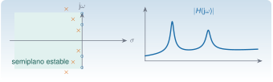

{.portada fig-alt="El plano complejo s con seis polos en el semiplano izquierdo y cuatro ceros sobre el eje imaginario, junto a la curva del módulo de una función de respuesta en frecuencia con dos resonancias"}

La transformada de Laplace convierte una ecuación diferencial en una ecuación algebraica. Lo que sale de ahí, la **función de transferencia**, resume cómo un sistema lineal responde a cualquier entrada, y tiene dos tipos de números que lo caracterizan: los **polos**, que son propiedades del sistema (frecuencias y amortiguamientos de los modos), y los **ceros**, que dependen de dónde se excita y dónde se mide. En identificación modal, los polos son lo que se quiere estimar, y los ceros explican por qué dos sensores del mismo edificio ven la misma estructura con formas tan distintas.

El sistema de un grado de libertad (polos, residuos, respuesta impulsional) está desarrollado en [M5](https://me1catrr.github.io/resonancia/mse/m05-vibraciones-i/index.html#m5-6). Esta unidad aporta lo que falta para varios grados de libertad: la matriz de transferencia, el efecto de los sensores y la conexión con la identificación.

::: {.callout-note}
## Cómo se lee esta unidad
**Tiempo orientativo:** unas 3 horas. **Nivel:** intermedio. Tres capas: **intuición** (mapa de polos y ceros, simulación), **fundamento** (definición, propiedades y teoremas) y **aplicación** (el edificio de tres plantas, [caso transversal](../../caso/edificio/index.qmd)).
:::


## Objetivos y prerrequisitos

**Objetivos.** Al terminar esta unidad sabrás:

- definir la transformada de Laplace y usar sus propiedades (linealidad, derivación, convolución, teorema del valor final) para resolver ecuaciones diferenciales lineales;
- obtener la función de transferencia de un sistema de varios grados de libertad y su descomposición en modos;
- relacionar los polos con los valores propios de la matriz de estado y con las frecuencias y los amortiguamientos modales;
- relacionar los ceros con la elección de entrada y salida, y explicar las antirresonancias;
- distinguir la función de transferencia $H(s)$ de la respuesta en frecuencia $H(\mathrm j\omega)$ y explicar por qué esta es la que se mide;
- decidir con los polos si un sistema es estable.

**Prerrequisitos.** [A2](../../algebra/valores-propios/index.qmd) (modos) y [M5](https://me1catrr.github.io/resonancia/mse/m05-vibraciones-i/index.html) (oscilador de un grado de libertad); [J3.6](https://me1catrr.github.io/resonancia/julia/j3-computacion/j3-6-edos/index.html) para las ecuaciones diferenciales.

## Apartados

::: {.indice-unidades .indice-apartados}

| Id | Apartado |
|----|----------|
| S1.1 | [La transformada de Laplace](s1-1.qmd) |
| S1.2 | [Función de transferencia](s1-2.qmd) |
| S1.3 | [Polos, estabilidad y valores propios](s1-3.qmd) |
| S1.4 | [Ceros y antirresonancias](s1-4.qmd) |
| S1.5 | [Respuesta en frecuencia y respuesta impulsional](s1-5.qmd) |
| S1 | [Práctica y cierre](practica.qmd) |

:::

```{=html}
<script>
// Las anclas de la antigua página única redirigen al apartado nuevo.
(function () {
  var m = {"def-laplace": "s1-1.html#def-laplace", "ej-ceros": "s1-4.html#ej-ceros", "ej-suma-modal": "s1-2.html#ej-suma-modal", "eq-modal": "s1-2.html#eq-modal", "eq-transferencia": "s1-2.html#eq-transferencia", "fig-polos-ceros": "s1-4.html#fig-polos-ceros", "lab-frf": "s1-4.html#lab-frf", "limites-sim1": "s1-4.html#limites-sim1", "pideselo": "practica.html#pideselo", "s1-1": "s1-1.html", "s1-2": "s1-2.html", "s1-3": "s1-3.html", "s1-4": "s1-4.html", "s1-5": "s1-5.html", "tbl-pares": "s1-1.html#tbl-pares", "tbl-valles": "s1-4.html#tbl-valles"};
  var h = decodeURIComponent(location.hash.slice(1));
  if (m[h]) location.replace(m[h]);
})();
</script>
```
