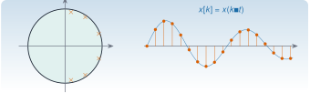

{.portada fig-alt="Un círculo unidad con tres pares de polos conjugados cerca de la circunferencia, junto a una señal oscilatoria amortiguada con sus muestras marcadas como puntos"}

Los sensores no dan señales continuas: dan **muestras** cada $\Delta t$. La transformada Z es a las señales discretas lo que la de Laplace a las continuas: convierte ecuaciones en diferencias en álgebra, y hace que la estabilidad, la frecuencia y el amortiguamiento se lean en el **plano $z$**, con una geometría muy distinta a la del plano $s$: el semiplano estable se convierte en el interior de un círculo, y las frecuencias, en ángulos. Esta unidad explica esa correspondencia, sus trampas (el *aliasing* y la ambigüedad del logaritmo) y la usa para extraer frecuencias y amortiguamientos de un modelo ajustado a datos.

::: {.callout-note}
## Cómo se lee esta unidad
**Tiempo orientativo:** unas 3 horas. **Nivel:** intermedio. Tres capas: **intuición** (figuras y simulación), **fundamento** (definición, correspondencia $z=e^{s\Delta t}$) y **aplicación** (identificar los polos de un edificio con un modelo autorregresivo, y ver lo que sale mal).
:::


## Objetivos y prerrequisitos

**Objetivos.** Al terminar esta unidad sabrás:

- definir la transformada Z y escribir la función de transferencia de un sistema descrito por una ecuación en diferencias;
- usar la correspondencia $z=e^{s\Delta t}$ para pasar de polos continuos a discretos y al revés, y obtener $f$ y $\zeta$ de un polo discreto;
- explicar el *aliasing* en el plano $z$ y por qué el logaritmo es multivaluado;
- reconocer los polos de un modelo AR en el plano $z$ y estimar con ellos frecuencias y amortiguamientos de un registro;
- reconocer los **polos espurios** y las limitaciones de ese método (orden, ruido, sesgo en el amortiguamiento).

**Prerrequisitos.** [S1](../../sistemas/laplace/index.qmd) (Laplace), [S2](../../sistemas/espacio-estados/index.qmd) (discretización exacta) y [A1.4](../../algebra/matrices/a1-4.qmd) (Toeplitz y Yule–Walker).

## Apartados

::: {.indice-unidades .indice-apartados}

| Id | Apartado |
|----|----------|
| S3.1 | [La transformada Z](s3-1.qmd) |
| S3.2 | [Del plano $s$ al plano $z$](s3-2.qmd) |
| S3.3 | [Modelos AR y sus polos](s3-3.qmd) |
| S3 | [Práctica y cierre](practica.qmd) |

:::

```{=html}
<script>
// Las anclas de la antigua página única redirigen al apartado nuevo.
(function () {
  var m = {"def-z": "s3-1.html#def-z", "ej-ar": "s3-3.html#ej-ar", "ej-z": "s3-2.html#ej-z", "eq-fz": "s3-2.html#eq-fz", "eq-z": "s3-2.html#eq-z", "fig-plano-z": "s3-2.html#fig-plano-z", "fig-polos-z": "s3-3.html#fig-polos-z", "lab-z": "s3-2.html#lab-z", "limites-sim1": "s3-2.html#limites-sim1", "pideselo": "practica.html#pideselo", "s3-1": "s3-1.html", "s3-2": "s3-2.html", "s3-3": "s3-3.html", "tbl-ar-edificio": "s3-3.html#tbl-ar-edificio"};
  var h = decodeURIComponent(location.hash.slice(1));
  if (m[h]) location.replace(m[h]);
})();
</script>
```
